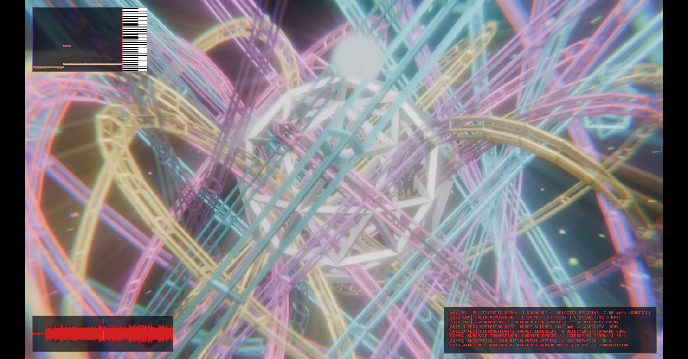

# musicvid

[](https://www.youtube.com/watch?v=fla70WAohFE)

> **Beat-synchronized 3D music video generator powered by Audio (.wav / .mp3) and MIDI (.mid) files.**

`musicvid` generates procedural, rhythm-synchronized music videos by pairing headless **Blender 3D** wireframes, geometric worlds, and space battles with **FFmpeg** audio visualizers, reactive HUD telemetry, and After Effects-style beat drop FX (camera shake, chromatic aberration glitch, and brightness flashes).

---

## Quickstart for Musicians & Producers

Whether you are on **macOS**, **Windows**, or **Linux**, getting started takes less than two minutes.

### macOS

1. **Install Prerequisites** (via [Homebrew](https://brew.sh)):
   ```bash
   brew install ffmpeg blender python
   ```
2. **Setup Environment**:
   ```bash
   git clone https://github.com/jamesabravo/musicvid.git
   cd musicvid
   ./setup.sh
   ```
3. **Generate Your First Video** (using the included example assets):
   ```bash
   ./musicvid -draft -inaudio examples/Skyline.wav -inmidi examples/Skyline.mid -outvideo draft.mp4
   ```

---

### Windows

1. **Install Prerequisites** (run in Command Prompt / Terminal via Windows Package Manager):
   ```cmd
   winget install Gyan.FFmpeg BlenderFoundation.Blender Python.Python.3.11
   ```
2. **Setup Environment**:
   * Double-click `setup.bat` (or run it in Command Prompt / PowerShell).
   * The script automatically configures the local Python environment.
3. **Generate Your First Video**:
   ```cmd
   musicvid -draft -inaudio examples\Skyline.wav -inmidi examples\Skyline.mid -outvideo draft.mp4
   ```

---

### Linux (Ubuntu / Debian / Fedora / Arch)

1. **Install Prerequisites**:
   * **Ubuntu / Debian**:
     ```bash
     sudo apt update && sudo apt install -y ffmpeg blender python3 python3-venv python3-pip
     ```
   * **Fedora**:
     ```bash
     sudo dnf install -y ffmpeg blender python3 python3-pip
     ```
   * **Arch Linux**:
     ```bash
     sudo pacman -S ffmpeg blender python
     ```
2. **Setup Environment**:
   ```bash
   ./setup.sh
   ```
3. **Generate Your First Video**:
   ```bash
   ./musicvid -draft -inaudio examples/Skyline.wav -inmidi examples/Skyline.mid -outvideo draft.mp4
   ```

---

## Two-Step Workflow: Draft -> Final

Generating 3D animation at full 1080p can take minutes/hours depending on hardware. To let you iterate in seconds/minutes, `musicvid` uses a two-phase workflow:

```
[Audio + MIDI]  --->  Step 1: Draft Mode (320x200 @ 15 FPS)  --->  Saves edit to .musicvid.json
                                                                           |
                                                                           v
                      Step 2: Final Mode (1080p @ 30 FPS)    <-------------+
```

### Step 1: Render an Ultrafast Draft

```bash
./musicvid -draft -inaudio track.wav -inmidi track.mid -outvideo draft.mp4
```
* **Speed:** Renders at `320x200` @ 15 FPS with `ultrafast` encoding (typically takes only 15–30 seconds).
* **Project File:** Automatically saves `draft.musicvid.json`, recording the exact camera cuts, procedural seeds, and scene assignments.

### Step 2: Render the High-Res Final

Once you like the pacing and visual edits of your draft, render the final video:
```bash
./musicvid -final draft.musicvid.json -outvideo final.mp4
```
* Slices the exact same scene cuts at full high resolution (`1920x1080` @ 30 FPS).
* Encodes with clean video quality (`-crf 19`, 256k audio).
* You don't need to re-enter your input audio or MIDI flags—everything is loaded from the project file.

---

## Configuration (`config.yaml`)

All global preferences and end-credit text can be customized directly in `config.yaml`.

### Customizing Terminal End Credits
`musicvid` renders a retro monospace demoscene terminal box at the end of every video. You can customize the artist name, song title, and social links in `config.yaml`:

```yaml
terminal_credits:
  enabled: true
  start_before_end_sec: 5.0    # Show credits box 5 seconds before end
  fade_before_end_sec: 3.0     # Smooth fade to black 3 seconds before end
  text: |
    ===============================================================
                        [[YOUR ARTIST NAME]]
                         "[[YOUR PLAYLIST]]"
    ===============================================================
                          [[YOUR DETAILS]]
                 [[Be kind - keep github URL below]]
             musicvid - https://github.com/jamesabravo/musicvid
    ===============================================================
                               [ EOF ]
```

### Customizing Video & Blender Paths
```yaml
video:
  default_resolution: "1920x1080"
  draft_resolution: "320x200"
  default_fps: 30
  draft_fps: 15
  default_genre: "electronic"
  default_themes:
    - "space"

blender:
  # Specify explicit path to Blender executable if installed in a non-standard directory
  custom_path: ""
```

### Customizing HUD & Telemetry Overlays with Replaceable Tags
All on-screen sci-fi HUDs, flight telemetry readouts, and planetary approach monitors support customizable template strings in `config.yaml` using dynamic replaceable tags (e.g. `__COORDS__`, `__RANGE__`, `__DESIGNATION__`, `__CLOSURE_RATE__`):

```yaml
overlays:
  # Planetary Approach / Intercept HUD (Corner Box)
  planet_orbital:
    header: "[ HUD // NAV-ORBITAL INTERCEPT ]            SYS.STAT: __SYS_STAT__"
    lines:
      - "   TARGET DESIGNATION : __DESIGNATION__"
      - "   TARGET CLASS       : __CLASS__"
      - "   CURRENT VECTOR     : [__COORDS__]"
      - "   RANGE TO PERIAPSIS : __RANGE__ KM"
      - "   CLOSURE RATE       : __CLOSURE_RATE__ KM/S __CRATE_LABEL__"
      - "   __ET_LABEL__: __ET__"

  # Cockpit Flight Visor HUD
  flight_hud:
    headers:
      orbital: "ORBITAL VECTOR LOCKED"
      descent: "DESCENT TRAJECTORY LOCKED"
    labels:
      speed: "SPEED"
      thrust: "THRUST"
      gforces: "G-FORCES"
      dist: "DIST"

  # Corner Subsystem Messages
  spaceship_telemetry:
    - "[SYS_BOOT] AVIONICS SUBSYSTEM SYNC [__BOOT_MS__ ms]... OK"
    - "TARGET_VEC:   [ X: __TX__m | Y: __TY__m | Z: __TZ__m ]"
    - "RANGE:        __RNG__ METERS // VELOCITY: __CVEL__ m/s CLOSING"
```

---

## Visual Themes

Pass one or more themes using `-themes "theme1,theme2"`:

| Theme | Description |
| :--- | :--- |
| `space` | Planets and moons with Cassini-division rings, wormhole tunnels, 360° starfields, and squadron formations. |
| `spaceships` | Squadron tactical cruisers, hyperspace jumps with axial elongation streaks, and high-speed viewer flybys. |
| `trippy` | Psychedelic sacred geometry: kaleidoscopic star corridors, 4D hypercube tesseracts, rotating Merkaba, and torus knots. |
| `synthwave` | Retro-futuristic cyberpunk highway: neon grid terrain, Venetian-blind sliced sun disc, and horizon skyscraper monoliths. |
| `vector_arcade` | 1980s vector CRT monitors (homage to *Battlezone*, *Tempest*, and *Asteroids*) in green, amber, and cyan phosphor wireframes. |
| `prismatic` | Iridescent bismuth hopper crystal terraces, faceted gemstone polyhedra, and rainbow chromatic dispersion flares. |
| `quantum` | High-energy particle collisions, Lorentz magnetic deflection arcs, and vibrating subatomic probability wave lattices. |
| `landscape` | Procedural fractal mountain canyons with dynamic aircraft banking S-turns and synthetic vision HUDs. |
| `story` | Continuous 3D narrative: deep space cruise -> atmospheric re-entry dive -> canyon flight -> ground tank battle -> transcendence. |

---

## Command Line Options

```bash
./musicvid [options] -inaudio <track.wav> -inmidi <track.mid> -outvideo <output.mp4>
```

| Option | Description | Default |
| :--- | :--- | :--- |
| `-draft` | Render ultrafast low-res draft video and write project JSON | `false` |
| `-final <project.json>` | Render high-res final video from an existing project JSON | `None` |
| `-config <path>` | Custom path to configuration YAML file | `./config.yaml` |
| `-inaudio <path>` | Input audio file (`.wav`, `.mp3`, `.flac`, `.ogg`) | *(Required)* |
| `-inmidi <path>` | Input MIDI file (`.mid`) | *(Required)* |
| `-outvideo <path>` | Output video file (`.mp4`) | *(Required)* |
| `-themes <list>` | Comma-separated list of visual themes | `space` |
| `-story [preset]` | Continuous story mode (`traveller`, `cyber`, `crystal`, `strike`) | `None` |
| `-palette <name>` | Force UI colorway palette (`cyberpunk_neon`, `nostromo_amber`, `matrix_phosphor`, etc.) | Auto from MIDI |
| `-piano-dir <dir>` | Force piano roll scroll direction (`up`, `down`, `left`, `right`) | Auto from MIDI |
| `-platform <name>` | Platform preset: `youtube` (1080p), `tiktok` / `shorts` (vertical 9:16), `retro` (320x200) | `None` |
| `-size <WxH>` | Custom output resolution (e.g. `1920x1080`, `1280x720`) | `1920x1080` |
| `-preview <sec>` | Render only the first N seconds for rapid testing | Full track |
| `-fps <fps>` | Video framerate | `15` (draft) / `30` (final) |
| `-fresh` / `-nocache` | Bypass clip cache and force fresh 3D rendering for all segments | `false` |
| `-clearcache` | Delete all cached 3D video clips and exit | `false` |
| `-novisualizer` | Disable spectrum analyzer & waveform overlay | Enabled |
| `-noshake` | Disable kick drum camera shake effect | Enabled |
| `-noglitch` | Disable snare drum RGB chromatic glitch effect | Enabled |
| `-noflash` | Disable loudness peak and drop brightness flashes | Enabled |
| `-nohud` | Disable on-screen telemetry HUD overlays | Enabled |

---

## Alternative: Running via Docker

For headless Linux servers, CI/CD pipelines, or users who prefer container isolation:

```bash
# Build and run the default demo
docker compose run musicvid

# Or mount your own audio and midi files
docker run --rm \
  -v "$(pwd)/my_music:/data/input:ro" \
  -v "$(pwd)/output:/data/output" \
  musicvid \
  -draft \
  -inaudio /data/input/track.wav \
  -inmidi /data/input/track.mid \
  -outvideo /data/output/track.mp4
```

---

## Troubleshooting FAQ

### "Blender was not found on your system"
Ensure Blender 3.6+ or 4.x is installed. If installed in a non-standard location:
1. Open `config.yaml` in any text editor.
2. Set `custom_path` under `blender:` to your executable, for example:
   * **macOS:** `/Applications/Blender.app/Contents/MacOS/Blender`
   * **Windows:** `C:\Program Files\Blender Foundation\Blender 4.2\blender.exe`
   * **Linux:** `/usr/bin/blender`

### "FFmpeg or FFprobe was not found"
Ensure `ffmpeg` and `ffprobe` are on your system `PATH`:
* **macOS:** `brew install ffmpeg`
* **Windows:** `winget install Gyan.FFmpeg`
* **Linux:** `sudo apt install ffmpeg`

### My MIDI notes are out of sync with my DAW export
If you exported your DAW track at a non-standard pitch or sample rate transpose:
Use the `-pitch <value>` flag (default: `63`). `musicvid` mathematically calculates the exact playback time factor to realign the MIDI note timestamps with the audio stream.

---

## See It in Action

To see full beat-synchronized renders, retro vector wireframes, and demoscene visuals created with `musicvid`:

* **YouTube:** [Orbital Decay Vibes (@OrbitalDecayVibes)](https://www.youtube.com/@OrbitalDecayVibes)

---

## License

This project is licensed under the [MIT License](LICENSE).
